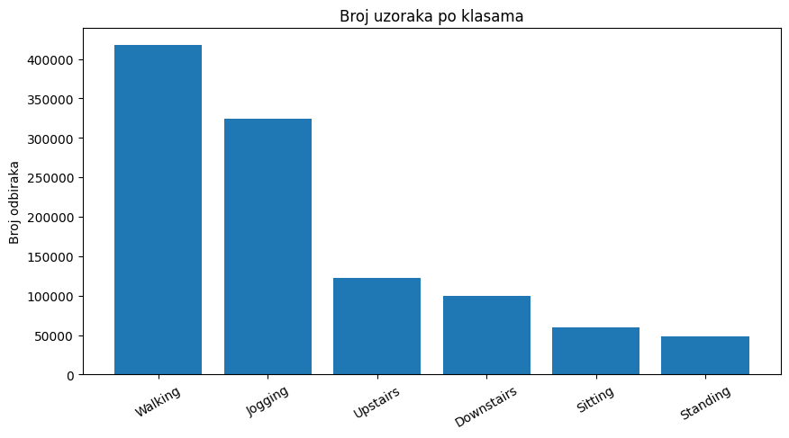
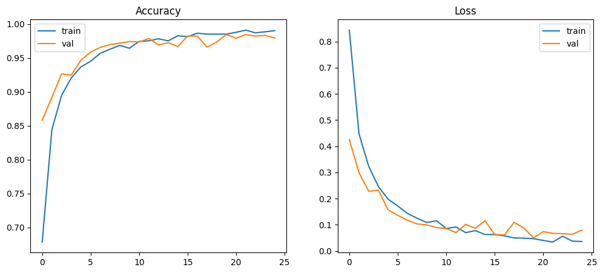
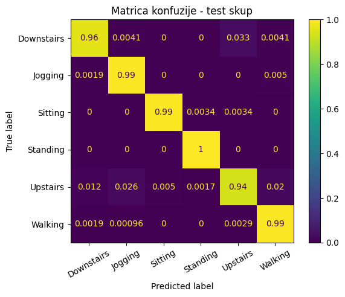

# Human Activity Recognition with Conv1D-LSTM

This project classifies human activities from three-axis smartphone accelerometer measurements using a hybrid Conv1D-LSTM neural network. It uses the WISDM activity-recognition dataset and covers preprocessing, class-imbalance handling, sequence generation, training, evaluation, and error analysis.

## Activities

- Downstairs
- Jogging
- Sitting
- Standing
- Upstairs
- Walking

## Data processing

- Invalid or incomplete samples are removed.
- Samples are ordered by user and timestamp.
- Signals are grouped into windows of 80 samples with a stride of 40 samples.
- Accelerometer features are standardized using statistics fitted on the training set.
- Class weights reduce the effect of class imbalance.
- Data is divided into training, validation, and test sets.



## Model architecture

```text
Input (80 x 3)
  -> Conv1D (32 filters, kernel size 5, ReLU)
  -> MaxPooling1D
  -> Conv1D (64 filters, kernel size 5, ReLU)
  -> MaxPooling1D
  -> LSTM (32 units)
  -> Dense (32 units, ReLU)
  -> Dropout (0.2)
  -> Dense (6 units, Softmax)
```

The network has 24,486 trainable parameters. It is trained with Adam, sparse categorical cross-entropy, balanced class weights, and early stopping based on validation accuracy.



## Reported results

| Dataset | Accuracy | Macro precision | Macro recall | Macro F1 |
| --- | ---: | ---: | ---: | ---: |
| Training | 99.2533% | 0.9900 | 0.9915 | 0.9907 |
| Test | 98.4196% | 0.9817 | 0.9792 | 0.9804 |



## Project structure

```text
.
|-- projekat_nm.py
|-- requirements.txt
|-- dataset/
|   |-- time_series_data_human_activities.csv
|   `-- zzzread.txt
|-- assets/
|   |-- class-distribution.png
|   |-- training-history.png
|   `-- test-confusion-matrix.png
`-- NM Projekat.docx
```

## Installation

Create and activate a virtual environment, then install the dependencies:

```bash
python -m venv .venv
python -m pip install -r requirements.txt
```

## Dataset setup

Download the [Human Activity Recognition dataset from Kaggle](https://www.kaggle.com/datasets/die9origephit/human-activity-recognition/data) and place the CSV file at:

```text
dataset/time_series_data_human_activities.csv
```

The CSV file is excluded from Git because of its size. The original WISDM dataset notice in `dataset/zzzread.txt` remains included for attribution.

## Usage

Run the training and evaluation script from the project directory:

```bash
python projekat_nm.py
```

Training time depends on the available CPU or GPU. The script displays the class distribution, training history, confusion matrices, and examples of correctly and incorrectly classified sequences.

## Report

The complete Serbian-language project report is available in [NM Projekat.docx](NM%20Projekat.docx).

## Dataset and citation

The data is distributed through the [Human Activity Recognition dataset on Kaggle](https://www.kaggle.com/datasets/die9origephit/human-activity-recognition/data) and originates from the [WISDM Activity Prediction Dataset](https://www.cis.fordham.edu/wisdm/). Its original dataset notice is included in [`dataset/zzzread.txt`](dataset/zzzread.txt).

If you use or redistribute the dataset, cite:

> Jennifer R. Kwapisz, Gary M. Weiss, and Samuel A. Moore. "Activity Recognition using Cell Phone Accelerometers." Proceedings of the Fourth International Workshop on Knowledge Discovery from Sensor Data, 2010.

## License

No software license has been added. The WISDM dataset remains subject to its original attribution and redistribution requirements.
